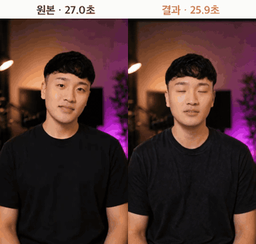

<!-- gitreels:start -->
<p align="center">
  <a href="https://gitreels.com/hotorch/avatar-shorts"></a>
  <br>
  <a href="https://gitreels.com"></a>
</p>
<!-- gitreels:end -->

# avatar-shorts

**English** | [한국어](README.ko.md)

**Drop in one selfie or avatar video. Get back a Short or Reel with silences trimmed, the hook moved to the front, and motion graphics that pop up on the words you say.**

In Claude Code, one line, `/shorts myvideo.mp4`, runs the whole job: transcription, caption correction, silence removal, hook reordering, B-roll, and sound effects.

<p align="center">
  
</p>
<p align="center">
  Watch with sound: <a href="docs/example/before.mp4">Original (27.0 s)</a> · <a href="docs/example/after.mp4">Result (25.9 s)</a>
</p>

- **Free, runs locally.** No API key needed. Speech recognition and rendering run on your own computer.
- **Never covers your face.** It measures where your head is and places the explainer graphics above the head, below the chin, in a split screen, or full screen, whichever fits.
- **Finishes without asking.** At the end it shows a table of what it decided and why. Point out only the parts you don't like.
- **Learns your taste.** Give it videos you like, or fix a result, and the next video follows that taste.

> 📚 **This is an educational project.** It is public to show how to hand a job to Claude Code end to end by attaching skills, policies, and checks. The making-of is on YouTube at [@ai.sam_hottman](https://www.youtube.com/@ai.sam_hottman) (Korean).

<p align="center">
  <a href="https://youtu.be/y-xpKr3rLBg"></a><br/>
  ▶ <a href="https://youtu.be/y-xpKr3rLBg">Watch the video made with this project (YouTube)</a>
</p>

## Quick start

**1. Requirements**

| | macOS | Windows |
|---|---|---|
| [Claude Code](https://claude.com/claude-code) (paid Claude plan) | Follow the site | Follow the site |
| [Node.js](https://nodejs.org) 18+ | LTS from the site | `winget install OpenJS.NodeJS.LTS` |
| [Python](https://www.python.org) 3.10–3.13 | `brew install python@3.12` | `winget install Python.Python.3.12` |
| [ffmpeg](https://ffmpeg.org) | `brew install ffmpeg` | `winget install Gyan.FFmpeg` |
| [Git](https://git-scm.com) | Typing `git` the first time opens an installer | `winget install Git.Git` |

Windows works in PowerShell without WSL. After installing everything, open a new PowerShell window.

**2. Install** (once, 5–10 min)

```bash
git clone https://github.com/hotorch/avatar-shorts.git
cd avatar-shorts
npm run setup      # downloads packages, speech recognition, browser, then runs diagnostics
npm run demo       # renders demos without a video → projects/_demo/
```

**3. Make one**

Start `claude` in the same folder and type:

```
/shorts ~/Desktop/myvideo.mp4
```

If you have a script, paste it on the next line. Captions get more accurate. A 30 s video takes 10–20 min, and the result lands in `projects/<name>/out/final.mp4`.

If something breaks, run `npm run doctor` first, then see [docs/TROUBLESHOOTING.md](docs/TROUBLESHOOTING.md) (Korean).

## Things to try saying

- "Keep scene 3 on my face, and add a conclusion card at the end"
- "Make the captions a bit bigger" / "Cut less silence" / "Shorten it to 45 s"
- "Show me the storyboard before rendering"
- "I want it to look like this video" (with a video file you like) / "Show me my taste"
- "Add this reference gradient to our policy"
- "I want to make B-roll with Google Flow. Give me prompts"

**Good source video:** 15–90 s of Korean speech, a quiet room, facing the camera with a little space above your head, a half-beat pause between sentences. Numbers or results you **did not say** in the video never appear on screen.

## Learn more

- [examples/avatar-v01/](examples/avatar-v01/): script, plan, and decision log for the video above
- [style/README.md](style/README.md): policy (break it and the result is wrong, render blocks it) and taste (choices). Your personal taste is saved in `style/me.json`, on your PC only
- [CLAUDE.md](CLAUDE.md): commands, code map, real pitfalls we hit
- What's inside: 12 templates, 62 3D objects, 6 fonts, 11 synthesized sound effects, 9 skills (`.claude/skills/`)

Docs inside the repo are written in Korean.

## FAQ

- **I don't see `/shorts`.** Start Claude Code **fresh** in this folder so it picks up the skills: `cd avatar-shorts && claude`.
- **It asks permission for every command.** The commands this kit uses and edits inside `projects/` are pre-allowed in [.claude/settings.json](.claude/settings.json). Read that file first if you're unsure.
- **Does it change my original video?** No. It copies it to `projects/<name>/input.mp4` and works on the copy.
- **Captions are inaccurate.** Giving the script along with the video is the surest fix. Mention proper nouns up front.

## Contributing

If you change code, run `npm test` (under a minute). If you fix a bug, add one test line to `scripts/selftest.mjs` and one line to "실제로 겪은 함정" (real pitfalls) in `CLAUDE.md`.

## License and credit

- Code: MIT. Keep the `LICENSE` file in your copy.
- **Credit appreciated** (not required, but it helps a lot):
  ```
  avatar-shorts by @ai.sam_hottman (YouTube) · hotorch (GitHub)
  https://github.com/hotorch/avatar-shorts
  ```
- Fonts OFL (`public/fonts/*-OFL.txt`) · 3D objects CC0 (`public/objects/LICENSE`) · face detection [YuNet](https://github.com/opencv/opencv_zoo/tree/main/models/face_detection_yunet) MIT (`models/yunet/LICENSE`)
- The render engine [Remotion](https://remotion.dev) is free for individuals and companies with 3 or fewer employees. Larger companies need a [company license](https://remotion.pro).
