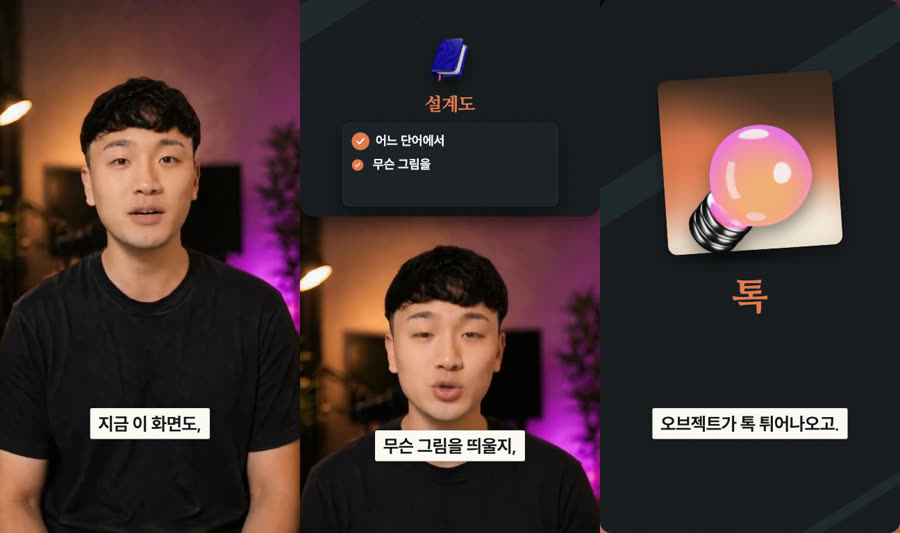
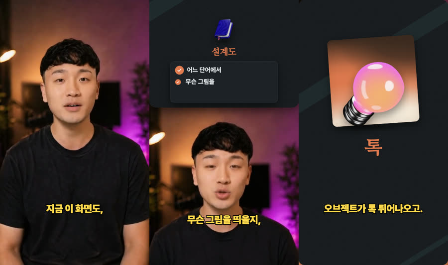
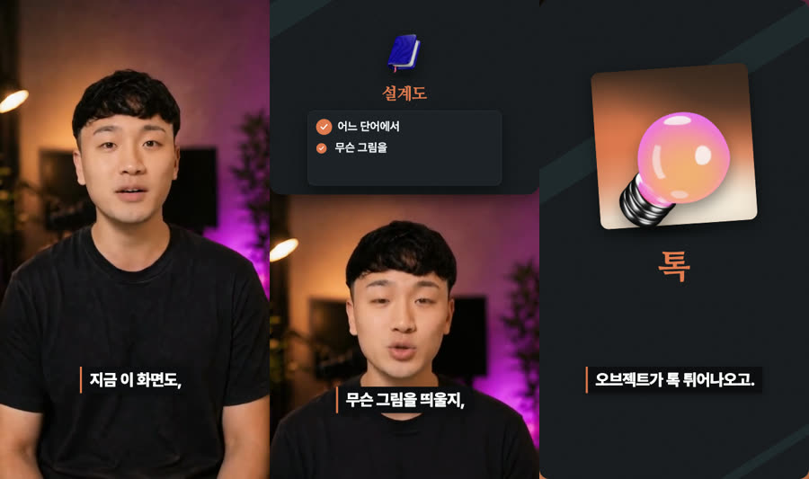
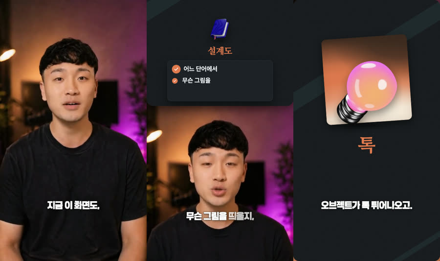
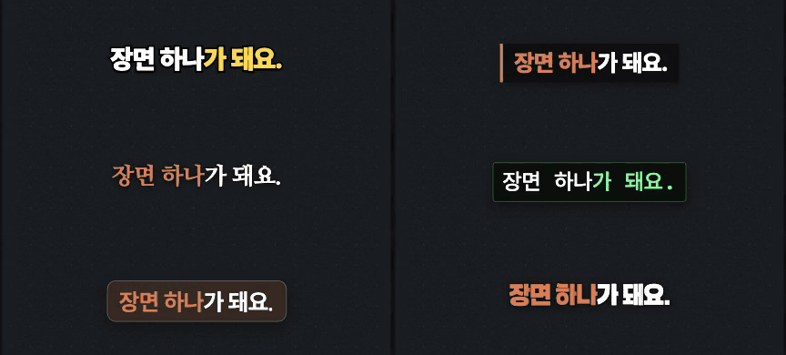
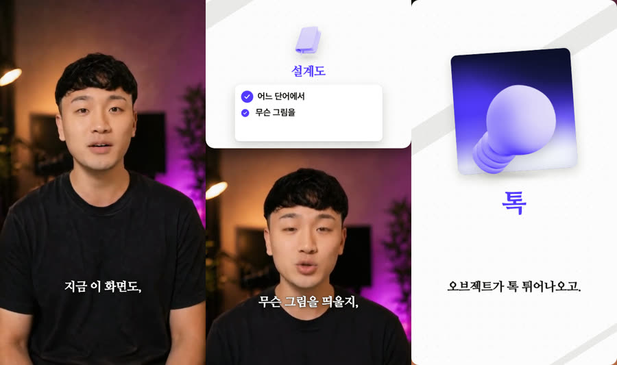
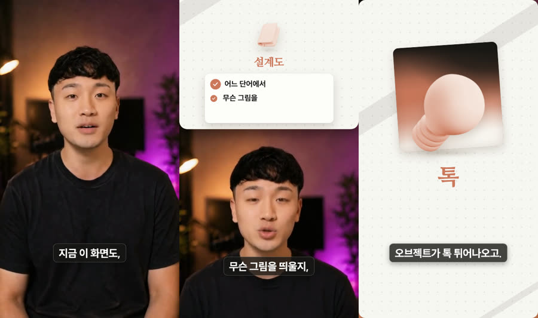
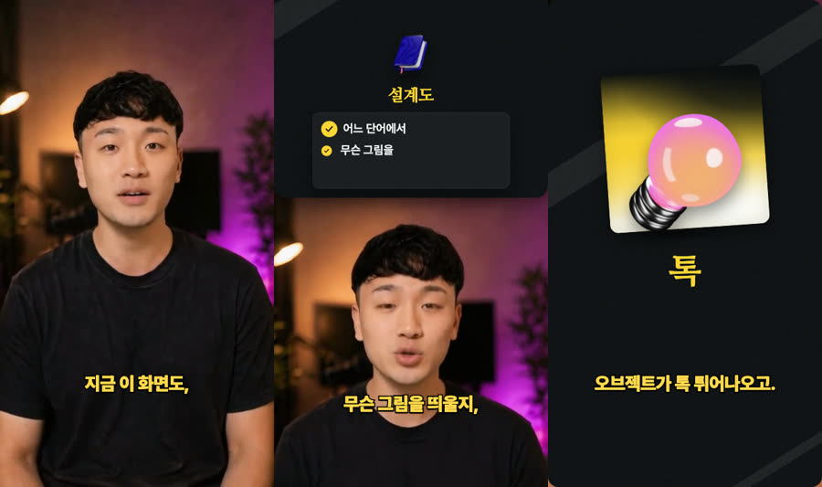

# 내 취향 입히기 — 고르고, 붙여 넣으면 끝

영상을 만들기 전에 **내 채널의 모양**을 정합니다. 5분이면 됩니다.

1. 아래 견본에서 고릅니다.
2. 맨 아래 **내 선택 메모**를 채웁니다.
3. Claude Code에 메모를 붙여 넣습니다.

고른 값은 내 PC에 저장되고, 그다음 영상부터 전부 그 모양으로 나옵니다. 나중에 말 한마디로 바꿀 수 있으니 부담 없이 고르세요.

> ⚡ **가장 빠른 길:** Claude Code에 `/onboarding`만 치세요. 질문 3개, 1분이면 끝납니다. 아래 매뉴얼은 견본을 보고 직접 고르고 싶을 때 쓰세요.

> 💡 **취향과 정책의 차이**
> 취향은 둘 다 맞고 **고르는 것**입니다. (자막 모양, 색)
> 정책은 어기면 **틀린 것**입니다. (지어내지 않기, 얼굴 가리지 않기)
> 그래서 어떤 세트를 골라도 글자는 말한 그대로, 얼굴은 안 가립니다.

---

## 1. 자막 세트 고르기

폰트, 자막 모양, 움직임을 묶은 세트입니다. **이름 하나만** 고르세요. 사진은 왼쪽부터 얼굴 화면, 위 칸 카드 화면, 전체 화면입니다.

### 기본
무엇이든 어울립니다. 고민되면 이것으로 시작하세요.



### 예능
노란 굵은 글자가 쾅. 리액션, 반전, 밈에 어울립니다.



### 뉴스
검은 띠에 또박또박. 정보와 이슈 정리에 어울립니다.



### 다큐
명조체가 초점 맞듯 나타납니다. 브랜드 필름, 인터뷰에 어울립니다.


### 터미널
초록 글자를 타자 치듯. 개발, AI, 코딩에 어울립니다.


### 테크
유리 상자가 쑥 올라옵니다. AI 도구, 앱 리뷰에 어울립니다. 상자 색은 브랜드 색을 따라갑니다.


### 에세이
손글씨 느낌의 글자가 단어씩 켜집니다. 일상, 감성, 공부에 어울립니다.



**움직임 비교** (왼쪽 위부터 예능 · 뉴스 / 다큐 · 터미널 / 테크 · 에세이)



### 한 칸만 바꾸고 싶다면 (선택)

세트를 고른 뒤 한 칸만 바꿀 수 있습니다. 예: `다큐인데 움직임만 쾅으로`

| 칸 | 고를 수 있는 것 |
|---|---|
| 폰트 | SUIT · Pretendard · 나눔명조 · 알림장 · Plex Mono |
| 자막 모양 | 흰 띠 · 검은 띠 · 유리 · 글자만 · 노란 글자 · 터미널 |
| 자막 움직임 | 없음 · 쾅 · 쑥 · 초점 · 타자 · 단어씩 |

---

## 2. 브랜드 색 고르기

장면의 바탕, 카드, 강조색이 전부 이 색을 따라갑니다. 세 가지 방법 중 **하나만** 고르세요.

### 방법 A. 좋아하는 브랜드 분위기 가져오기

1. [getdesign.md](https://getdesign.md)에서 마음에 드는 브랜드를 고릅니다.
2. 브랜드 페이지의 **Preview** 칸에서 **DESIGN.md** 탭을 누릅니다.
3. 오른쪽 **Copy**를 누릅니다.
4. Claude Code에 `이 브랜드 색으로 입혀줘`라고 쓰고 그대로 붙여 넣습니다.

같은 영상에 세 문서를 입혀 본 모습입니다.

**Stripe 문서** — 흰 바탕에 보라 + 다큐 세트



**Claude 문서** — 크림 바탕에 테라코타 + 테크 세트



**Binance 문서** — 어두운 바탕에 노랑 + 예능 세트



> ⚠️ **색 값만 가져옵니다.** 브랜드 이름, 로고, 서체는 내 영상에 들어가지 않습니다. 분위기를 참고하는 것이지 그 회사인 척하는 게 아닙니다. 이름은 그 브랜드를 찾기 위한 표시일 뿐입니다.

### 방법 B. 내 브랜드 색이 있다면

메모에 색 값 하나만 적으면 나머지는 그 색에서 만듭니다.

```
강조색: #FF5A5F
```

### 방법 C. 모르겠다면

아무것도 적지 마세요. 영상 배경에 어울리는 색을 자동으로 고릅니다.

> 💡 **색이 조금 달라질 수 있습니다.** 글자가 안 읽히면 틀린 영상이라서, 읽힐 만큼만 색을 조정합니다. 밝은 노랑처럼 흰 바탕에서 안 읽히는 색은 어두운 바탕으로 바뀝니다. 바뀐 내용은 Claude가 알려 줍니다.

---

## 3. 편집 리듬 고르기 (선택)

그대로 두면 기본값으로 만듭니다. 바꾸고 싶은 줄만 메모에 적으세요.

| 항목 | 고를 수 있는 것 | 기본 |
|---|---|---|
| 무음 | 타이트 · 보통 · 거의 안 자름 | 타이트 |
| 훅 | 앞으로 · 말한 순서 그대로 | 앞으로 |
| B-roll | 많이 · 보통 · 적게 | 많이 |
| 자막 크기 | 0.8 ~ 1.3 | 1.0 |
| 효과음 | 0 ~ 1 (끄려면 0) | 0.5 |
| 최대 길이 | 초 단위 | 60 |

---

## 4. 내 채널 규칙 정하기 (선택)

취향은 고르는 것이고, 채널 규칙은 **어기면 렌더가 막는 것**입니다. 꼭 지키고 싶은 것만 적으세요.

| 규칙 | 범위 | 기본 |
|---|---|---|
| 자막 한 줄 글자 수 | 12 ~ 18자 | 18자 |
| 한 자막의 강조 개수 | 0 ~ 2개 | 2개 |
| 첫 몇 초는 얼굴 | 1 ~ 3초 | 1초 |
| 한 장면 최대 길이 | 5 ~ 10초 | 10초 |

규칙은 더 엄격하게만 바꿀 수 있습니다. 지어내지 않기, 말한 그대로 자막, 얼굴 가리지 않기는 끌 수 없습니다. 고정하기 전에 Claude가 한 번 확인합니다.

---

## 5. 내 선택 메모

고른 것만 남기고 지워도 됩니다. 이 메모를 그대로 Claude Code에 붙여 넣으세요.

```
온보딩:
자막 세트: 테크
강조색: #FF5A5F
무음: 보통
B-roll: 보통
내 채널 규칙: 자막 14자
```

getdesign.md 문서를 쓴다면 `강조색` 줄 대신 복사한 문서를 메모 아래에 붙여 넣습니다.

**메모를 붙여 넣으면**

1. 고른 값이 내 취향과 채널 규칙에 저장됩니다.
2. 예시 영상에 입힌 **내 디자인 1장**이 나옵니다. (`projects/taste-sample/out/my-design.png`)
3. 마음에 들면 바로 영상을 만듭니다.

```
/shorts ~/Desktop/내영상.mp4
```

---

## 6. 나중에 바꾸기

그냥 말하면 됩니다.

| 이렇게 말하세요 | 일어나는 일 |
|---|---|
| `자막 세트 다큐로` | 자막 세트를 바꿉니다 |
| `움직임만 쾅으로` | 세트는 두고 한 칸만 바꿉니다 |
| `강조색 #2F5BEA로` | 브랜드 색을 바꿉니다 |
| `브랜드 색 지워줘` | 자동 색으로 돌아갑니다 |
| `내 설정 보여줘` | 지금 저장된 취향을 봅니다 |

> 💡 **이 영상만 다르게 하고 싶다면** `이번 영상만 뉴스 세트로`처럼 말하세요. 내 취향은 그대로 남습니다.
